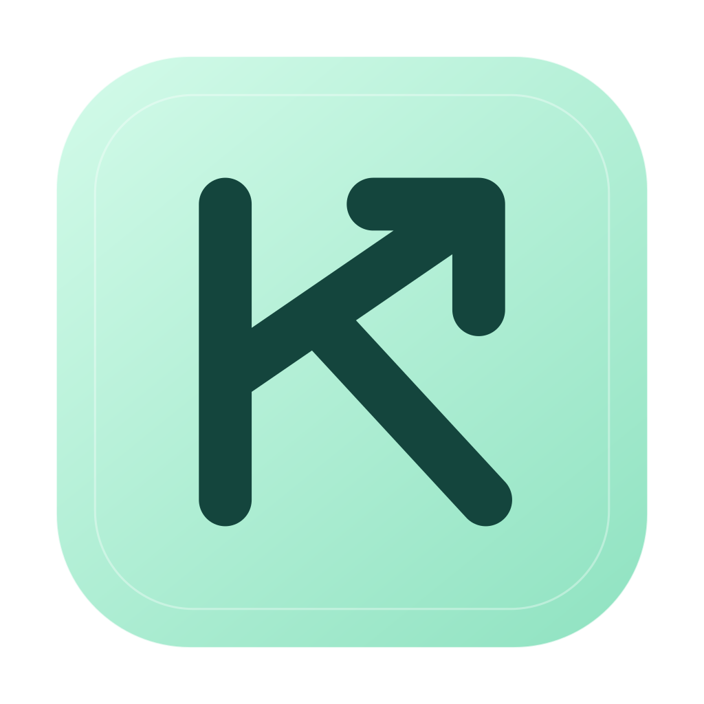
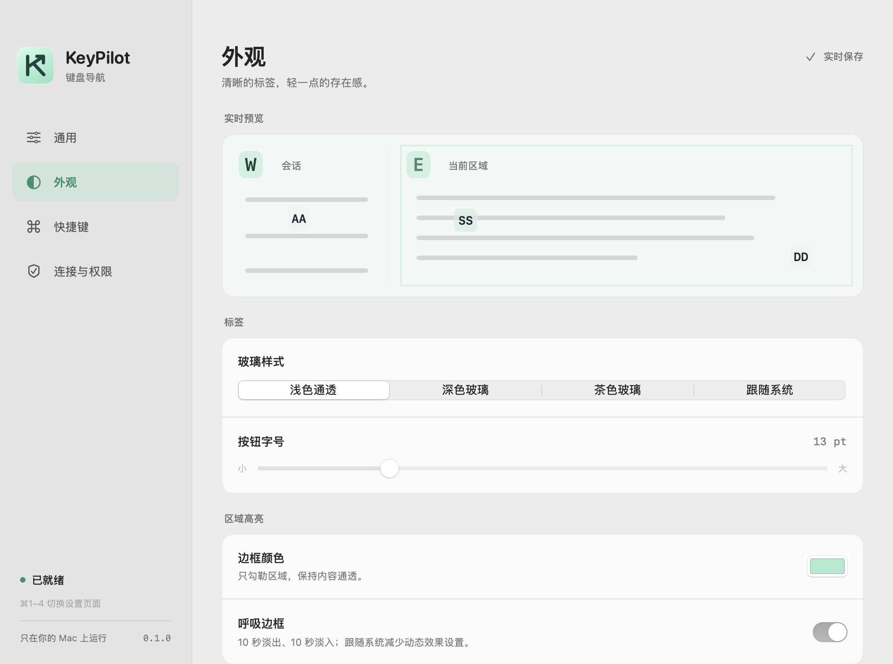

<p align="center">
  
</p>

# KeyPilot

**用键盘选区域、点按钮、滚动页面。**

KeyPilot 是一个原生 macOS 菜单栏工具：按下快捷键，为前台窗口中可操作的控件显示字母标签，输入标签即可点击。用 `J` / `K` 滚动，用 `I` 临时输入文字，让双手更少离开键盘。

Native keyboard navigation for macOS, built with Swift, AppKit, and Accessibility APIs.

**macOS 13+ · Swift 5.9+ · 无第三方包依赖 · 本机运行 · [MIT](LICENSE)**

[下载安装](#开始使用) · [源码构建](#从源码构建) · [快捷键](#快捷键) · [常见问题](#常见问题) · [开发](#开发) · [来源与许可](docs/PROVENANCE.md)

## 可以做什么

| 能力 | 使用方式 |
| --- | --- |
| 按区域导航 | 用 `W` / `E` / `R` 或 `Tab` 在侧栏、内容区等区域间切换 |
| 标签点击 | 输入两位或三位字母码；也可用方向键选择后按 `Return` 确认 |
| 连续滚动 | 按住 `J` / `K` 向下 / 向上滚动，按住 `Shift` 加速 |
| 展开行内操作 | 按 `;` 再输入行标签，悬停并展开该行的次要操作 |
| 临时输入 | 按 `I` 透传文字与快捷键，按 `Esc` 回到导航 |
| 调整外观 | 浅色、深色、茶色、跟随系统；可调字号、边框颜色和动画 |



*由实际设置视图离屏渲染的示例，标签内容为模拟数据；不代表第三方应用兼容性或桌面实时毛玻璃效果。*

## 开始使用

当前提供 **0.1.0（build 17）未公证测试版**，包含 Apple Silicon 与 Intel 两种架构，无需安装 Xcode、Swift 或 Python。

**[下载 macOS 通用版 DMG](https://github.com/CillianWang/keypilot/releases/download/v0.1.0/KeyPilot-0.1.0-macOS-universal.dmg)** · [ZIP 备用下载](https://github.com/CillianWang/keypilot/releases/download/v0.1.0/KeyPilot-0.1.0-macOS-universal.zip) · [发布说明与校验文件](https://github.com/CillianWang/keypilot/releases/tag/v0.1.0)

1. 打开 DMG，将 `KeyPilot.app` 复制到个人「应用程序」文件夹（`~/Applications/`）；若文件夹不存在，可在个人主文件夹下新建 `Applications`。
2. 打开 App，在「系统设置 → 隐私与安全性 → 辅助功能」中授权，再从菜单栏选择「重新连接」。
3. 切到目标窗口，按 `⇧⌘Space` 开始导航，按 `Esc` 退出。

当前包使用 Apple Development 证书签名，**尚未经过 Apple 公证**。首次打开若提示无法验证开发者，请在确认下载来源后按 [Apple 的官方说明](https://support.apple.com/en-us/102445)，在「隐私与安全性」中选择「仍要打开」。完整步骤见 [Mac 安装说明](docs/INSTALL.md)。

## 从源码构建

需要修改或自行构建时，再按下面的流程准备开发环境。只使用应用可以直接下载上面的安装包。

### 1. 准备环境

- macOS 13 或更高版本。
- 支持 Swift 5.9+ 的 Xcode 或 Command Line Tools，以及 Python 3。
- 用于本机安装的有效代码签名证书及其私钥。

先确认命令行工具可用：

```sh
swift --version
python3 --version
```

如缺少开发工具，可运行 `xcode-select --install`。如工具提示 Xcode 许可未接受，请先在 Xcode 中阅读并完成许可与首次启动设置，再继续构建。

### 2. 获取代码并运行测试

```sh
git clone https://github.com/CillianWang/keypilot.git
cd keypilot
swift test
```

单元测试不需要初始化签名，也不需要授予辅助功能权限；其中包含 AppKit 和 XCTest 测试，需要在 macOS 上使用带有 XCTest 的开发环境。若 Command Line Tools 缺少 XCTest，请安装完整 Xcode 并完成首次启动设置。

### 3. 初始化本机签名

KeyPilot 固定使用同一个签名身份和安装路径，降低更新时辅助功能授权失效的可能性。每台新机器都需要初始化自己的签名，仓库不包含开发者的证书或私钥。

在「钥匙串访问」的「证书助理 → 创建证书」中创建用于**代码签名**的本机证书，或使用已有的有效开发证书。然后列出可用身份：

```sh
security find-identity -v -p codesigning
```

将下面的占位内容替换为输出中的 **40 位 SHA-1 指纹**：

```sh
python3 scripts/signing.py init --identity '替换为你的40位证书SHA1指纹'
python3 scripts/signing.py check
```

如果命令没有列出有效身份，请先确认钥匙串中的证书、关联私钥及其信任状态。脚本不会自动创建证书，也不会在失败时退回临时签名。已有 KeyPilot 安装时，需要沿用原签名身份。

### 4. 构建与安装

```sh
bash scripts/build.sh
python3 scripts/install.py
```

构建产物在 `dist/KeyPilot.app`。安装脚本会备份现有 App、偏好与签名配置，验证产物后安装到 `~/Applications/KeyPilot.app`，并启动应用。

### 5. 授权并试用

1. 在菜单栏找到 KeyPilot，打开「设置… → 连接与权限」。
2. 打开「系统设置 → 隐私与安全性 → 辅助功能」，允许 `~/Applications/KeyPilot.app`。
3. 回到 KeyPilot，点击「重新连接」，确认「辅助功能权限」和「全局快捷键」就绪。
4. 切换到要操作的窗口，按 **`⇧⌘Space`** 开始导航。

第一次可以按这个顺序试用：**唤出 → `Tab` 选择区域 → 输入屏幕上的按钮标签 → `J` / `K` 滚动 → `Esc` 退出**。默认完整标签匹配后自动点击，可在「通用」中关闭。

应用只显示菜单栏图标；关闭设置窗口后仍继续运行。首次安装后看到“辅助功能权限待授权”是预期状态。它不需要录屏权限，也不会自动设置开机启动。

## 快捷键

除唤出快捷键外，下表操作均在导航模式中使用。`⇧` 是 Shift，`⌘` 是 Command。标签按物理键位识别，不依赖当前输入法。

| 按键 | 行为 |
| --- | --- |
| `⇧⌘Space` | 进入或完全退出导航 |
| `⇧⌘J` | 进入导航；已在导航中时不退出 |
| `W` / `E` / `R` | 选择区域；区域较多时使用屏幕上的两位区域码 |
| `Tab` / `⇧Tab` | 下一个 / 上一个区域；超过九个区域时可跨组切换 |
| 两位或三位按钮标签 | 完整匹配后自动点击；关闭自动点击时需按 `Return` |
| `↑` / `↓`，`Return` | 在当前页选择目标并左键点击 |
| `⇧Return` / `⌘Return` | 右键点击 / Command 点击当前目标 |
| `J` / `K` | 按住向下 / 向上滚动；同时按住时停止 |
| `Shift` | 按住时加速滚动，默认 2.5 倍 |
| `gg` / `Home` | 滚动到顶部 |
| `⇧G` / `End` | 滚动到底部 |
| `Space` | 显示全窗口及应用菜单的全量候选，包括折叠的行内操作 |
| `;` → 行标签 | 选择并悬停该行，展开其操作按钮；不会点击该行 |
| `;`（已展开时） | 收起行内操作 |
| `[` / `]` | 上一页 / 下一页标签 |
| `Backspace` | 删除已输入的标签前缀 |
| `I` | 临时输入模式，文字和应用快捷键透传 |
| `Esc` | 输入模式回到导航；导航模式直接退出 |

点击后继续导航。输入按钮标签的前缀期间，`J` / `K` 等按键优先用于补全标签；需要重新滚动时先用 `Backspace` 清空前缀。

默认收起可识别列表行中的次要操作，减少标签拥挤。`Space` 可随时查看全量候选，也可在设置中关闭「按需展开列表行操作」。滚动、切区或临时输入会结束当前行的展开状态。

## 隐私与本地数据

KeyPilot 通过 macOS Accessibility API 读取前台应用的控件结构，并通过系统事件执行点击和滚动。应用不包含网络请求、云端服务、OCR 或屏幕截图逻辑；不会上传遥测，不记录输入文字、窗口标题、控件正文或 URL。

| 数据 | 位置 |
| --- | --- |
| 应用 | `~/Applications/KeyPilot.app` |
| 偏好 | macOS UserDefaults，域名 `dev.pingy.keypilot` |
| 固定签名配置、就绪状态 | `~/Library/Application Support/KeyPilot/` |
| 安装备份 | `~/Library/Application Support/KeyPilot/Backups/` |
| 本地诊断日志 | `~/Library/Logs/KeyPilot/metrics.jsonl` |

日志只记录计数、耗时、模式与错误状态，达到约 2 MB 后清理。签名私钥保留在系统钥匙串中。`artifacts/`、`.build/`、`dist/` 属于本机构建或验证输出，已被 Git 忽略。

## 常见问题

| 问题 | 处理方式 |
| --- | --- |
| 安装后没有主窗口 | KeyPilot 是菜单栏应用，从菜单栏打开「设置…」；退出请使用菜单中的「退出 KeyPilot」 |
| 快捷键没有反应 | 确认应用已启用、辅助功能权限已授予，再点「重新连接」；检查其他应用是否占用了相同快捷键。当前版本的两组唤出快捷键固定 |
| 某个控件没有标签 | 尝试切换区域或按 `Space`；自绘控件若未向 Accessibility API 暴露结构，目前无法可靠识别 |
| 标签太多，或出现看不见的按钮 | 启用按需展开行操作。部分应用会把透明按钮也暴露给辅助功能接口，KeyPilot 无法仅凭该接口准确判断视觉可见性 |
| 更新时提示签名身份不匹配 | 恢复原证书及私钥，保留原签名配置；脚本会拒绝无声替换身份 |
| 命令行自检的权限状态与 App 不同 | 终端派生进程的权限归属可能不同，以正常启动 App 的「连接与权限」页为准 |

**兼容性边界：**部署目标为 macOS 13+；现有记录主要来自 Apple Silicon 上的 macOS 15.8。Intel、其他系统版本、多显示器及不同应用的事件链仍需更多实机验证。测试覆盖不等于所有应用兼容，详细记录见 [验证记录](docs/VALIDATION.md)。

## 开发

项目使用 Swift Package Manager，直接调用系统框架，没有外部 Swift 包。Python 脚本只使用标准库和仓库内模块。

```text
Sources/KeyPilotCore/        状态机、编码、布局、区域与扫描逻辑
Sources/KeyPilot/            AppKit / SwiftUI、辅助功能、事件投递与设置
Tests/KeyPilotCoreTests/     核心行为与边界条件测试
Tests/KeyPilotRuntimeTests/  AppKit、输入投递与设置测试
Resources/                  App 元数据与矢量图标
scripts/                    签名、构建、安装与验证
docs/                       设计、验证记录与来源说明
```

日常修改先运行：

```sh
swift test
```

完整本地回归还需要已初始化的签名身份和已构建的 `dist/KeyPilot.app`：

```sh
bash scripts/build.sh
bash scripts/regression.sh
python3 scripts/performance.py
```

性能报告使用实际操作产生的本地诊断日志，没有样本时不能作为性能结论。历史 build 16 记录包含 93 项 XCTest 通过的结果；参见 [验证记录](docs/VALIDATION.md)，这不是持续集成状态。

<details>
<summary>生成预览、图标与诊断信息</summary>

```sh
# 真实设置视图的示例渲染；使用隔离偏好
dist/KeyPilot.app/Contents/MacOS/KeyPilot --render-settings "$PWD/artifacts/settings"

# 从项目内矢量绘制代码导出 PNG 和 iconset
dist/KeyPilot.app/Contents/MacOS/KeyPilot --export-brand "$PWD/artifacts/brand"

# 查看命令行进程的基本状态
~/Applications/KeyPilot.app/Contents/MacOS/KeyPilot --self-check

# 读取前台窗口的结构计数；需要该进程具备辅助功能权限
~/Applications/KeyPilot.app/Contents/MacOS/KeyPilot --scan-frontmost
```

</details>

更详细的实现取舍见 [设计说明](docs/DESIGN.md)。提交 [Issue](https://github.com/CillianWang/keypilot/issues) 时，请附上 macOS 版本、芯片架构、应用版本、目标应用与复现步骤；只分享必要的诊断信息。

维护者可构建通用二进制并生成包含许可、说明及 SHA-256 校验文件的安装包：

```sh
bash scripts/build.sh --universal
# 先提交本次发布涉及的源码和文档，保留可追溯的 Git 版本
python3 scripts/package-release.py
```

输出在 `dist/releases/`。打包脚本要求已提交的工作区，沿用现有固定签名身份，不进行 Apple 公证；详见 [发布构建记录](docs/RELEASE-0.1.0.md)。

## 许可证与来源

本仓库采用 [MIT 许可证](LICENSE)，允许商用、修改和再发布，需保留版权及许可声明。

仓库内的来源盘点与检索边界见 [来源与许可检查](docs/PROVENANCE.md)。Apple 系统框架、系统字体和 SF Symbols 由操作系统提供，其权利不因本项目采用 MIT 而改变。
